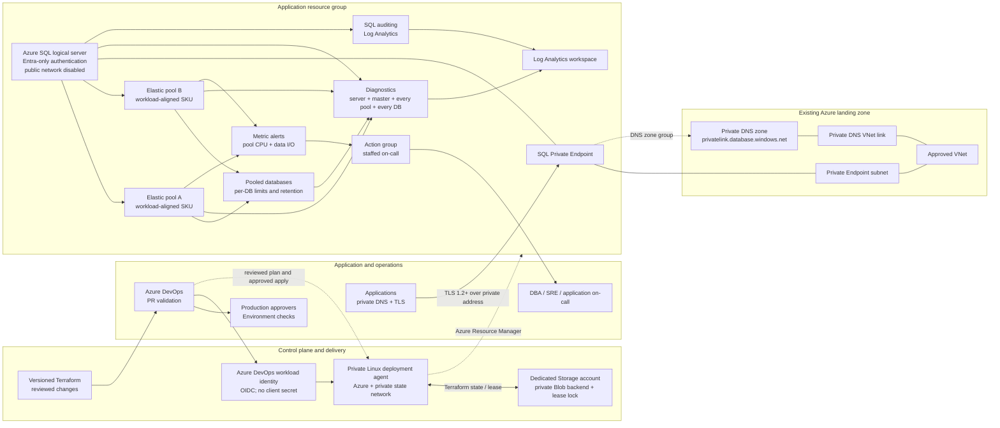
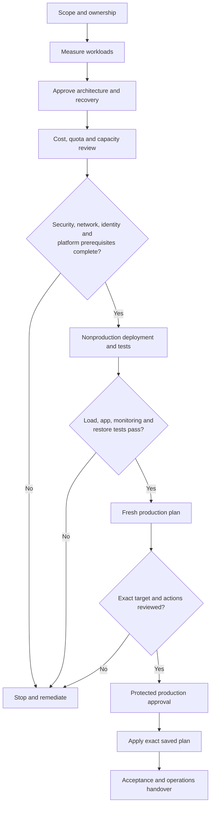
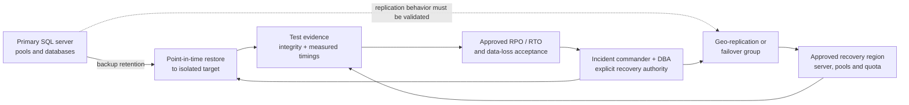

# Production reference architecture

## Design boundary

This design is for Azure SQL Database elastic pools (not Azure SQL Managed
Instance). Terraform creates resources in one application resource group. It
consumes, but does not own, the shared VNet, endpoint subnet, Private DNS zone,
DNS zone link, state-storage account, identity, and policy baseline. The
platform/network teams must provision and approve those prerequisites first.
The reference is a design contract; adjust it for the organization's landing
zone, region, regulatory requirements, and workload measurements.

## Topology

The editable source diagrams for the deployment lifecycle and recovery
topology are in [`../diagrams/`](../diagrams/README.md). These designs are
references only; validate the actual landing zone, resource ownership, Azure
service support, and recovery procedures before implementation.

### Delivery lifecycle

### Recovery topology

## Trust boundaries and network paths

| Path | Required design |
| --- | --- |
| Application to SQL | Resolve the SQL server FQDN to its private address through the linked Private DNS zone. Permit TCP 1433 only from approved application subnets. Require encrypted connections and validate certificate/hostname behavior in each client. |
| Terraform agent to Azure | Use an Azure DevOps Azure Resource Manager service connection configured for workload identity federation. Scope RBAC to the application resource group and the exact network/DNS resources needed. No saved client secret. |
| Terraform agent to state | Use the AzureRM backend with Microsoft Entra data-plane authorization and Blob leases. Place the storage account behind private networking; the deployment agent must resolve and reach its private endpoint. Do not use access keys or SAS tokens. |
| Azure SQL to monitoring | Configure diagnostic settings on the logical server, every pool, and every database. Apply approved workspace access, retention, region, and cost controls. Diagnostic export is not an application connection path. |
| Recovery region | Provision and test the selected geo-replication/failover-group design separately. Specify secondary servers/pools, capacity, quotas, DNS/listener behavior, application retries, and data-loss acceptance. |

## Resource ownership

| Resource | Owner | Terraform behavior |
| --- | --- | --- |
| Resource group and regional SQL/monitoring resources | Database platform team | Create/manage in the deployment stack. |
| Logical server, Entra administrator, pools, databases, Private Endpoint | Database platform team, with network approval | Create/manage. Public network access is disabled; Entra-only authentication is enabled. |
| VNet, endpoint subnet, routing, NSGs, Private DNS zone and VNet link | Network/platform team | Reference by resource ID only; do not take ownership of shared network resources. |
| Log Analytics retention/access policy and Azure Policy | Observability/security/platform teams | Set the workspace retention input and inherit approved organizational policies. |
| Terraform state account, container, networking, data-plane RBAC | Platform/IaC administrators | Bootstrap and secure before the deployment pipeline runs; never store the state account key in the repo or pipeline. |
| Azure DevOps project, agent pool, service connection, variable group, protected environment | DevOps/platform administrators | Configure out-of-band; require review and production approval. |
| Failover group, geo-replication, secondary-region capacity and drills | Service owner and DBA/SRE | Design and validate to approved RPO/RTO; this starter root module does not silently create a DR topology. |

## Capacity and placement decisions

1. Inventory databases by owner, environment, region, compliance boundary,
   latency, criticality, service tier, and recovery objective.
2. Collect representative peak and percentile CPU, data I/O, log I/O, worker,
   storage, session, and concurrency measurements. Include month-end, batch,
   reporting, and incident/replay peaks.
3. Pool only databases with compatible workload behavior and isolation needs.
   Separate consistently hot or regulated workloads when shared capacity
   creates noisy-neighbor or failure-domain risk.
4. Select vCore tier, hardware family, zone redundancy, pool capacity, maximum
   storage, and per-database minimum/maximum from measured load, regional SKU
   support, quotas, licensing, feature needs, and current cost estimates.
5. Define headroom and actionable scale thresholds. Alerting is not a substitute
   for capacity planning or workload testing.
6. Size the recovery region independently; confirm quota and enough pool
   capacity to support the required service level after failover.

## Resilience and backup model

Azure SQL provides automated backups and point-in-time restore. Set short-term
retention to the approved recovery policy in Terraform. Decide long-term
retention, backup redundancy, legal hold, and restore-isolation requirements
with compliance and service owners. This starter does not silently enable
cross-region replication or claim a backup is a tested restore.

Document per service: RPO, RTO, recovery decision owner, restore target, key
dependencies, listener/DNS change, application retry behavior, and the last
successful restore/failover evidence. Perform a restore to an isolated target
before production acceptance and schedule recurring drills.

## Security baseline

- Use Microsoft Entra-only SQL authentication and grant access to managed
  identities or approved Entra groups. Do not put SQL login passwords in
  Terraform, source control, pipeline variables, or command history.
- Keep public network access disabled. Use Private Link, private DNS, approved
  network routes, and application-subnet controls; validate from the actual
  workload network.
- Use workload identity federation for Azure DevOps, least-privilege Azure
  RBAC, branch protection, mandatory reviewers, and environment approvals.
- Keep Terraform state private, encrypted, backed up, access-audited, and
  restricted to the deployment identity and state administrators.
- Use Azure Policy, Defender for SQL, auditing, vulnerability management,
  resource locks where appropriate, and approved diagnostic retention.
- Keep tags, ownership, cost allocation, data classification, incident
  contacts, and deletion/restore controls consistent with the landing zone.

## Terraform-managed resources and deliberate omissions

`terraform/production` creates the logical server, configurable pools and
databases, SQL Private Endpoint with a DNS zone group, Log Analytics workspace,
server auditing, server/master/pool/database diagnostic settings, an on-call
email action group, and per-pool CPU/data-I/O metric alerts. It consumes
existing network IDs and does not connect to or alter application data.

It does not create a VNet, DNS zone/link, state backend, Azure DevOps identity
or approvals, firewall exception, SQL user, failover group, application
connection string, workload, or production capacity decision. Those boundaries
are intentional; complete the matching runbook gate and obtain the owning
team's approval before deployment.
