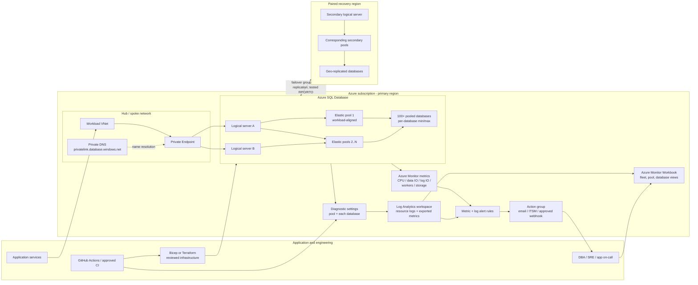

# Reference architecture and component definitions

## Scope and assumptions

This reference targets **Azure SQL Database elastic pools** (not Azure SQL
Managed Instance), initially at a scale of 10+ pools and 100+ pooled
databases. It assumes at least one Azure region, separated production and
nonproduction environments, and centralized Azure Monitor operations.
Choose pool count and placement from workload isolation, latency, compliance,
quota, and recovery requirements; "10+ pools" is a planning scale, not a
prescribed target.

## End-to-end architecture

The Mermaid source is also available in
[`../diagrams/azure-sql-elastic-pool-platform.mmd`](../diagrams/azure-sql-elastic-pool-platform.mmd).

## Components

| Component | Definition and purpose |
| --- | --- |
| Azure subscription and resource groups | Administrative and billing boundary. Separate production from nonproduction; group resources by ownership, region, or service boundary. Apply Azure Policy, RBAC, budgets, and consistent tags. |
| Azure SQL logical server | Management and connection namespace for Azure SQL databases and pools. It is not a customer-managed SQL Server VM. Apply Microsoft Entra authentication, network controls, auditing, and security policies at the appropriate scope. |
| Elastic pool | Shared compute/storage budget for multiple Azure SQL databases. Each database can have per-database minimum and maximum resources. Pools suit databases with variable, non-overlapping peaks; avoid pooling persistently saturated or incompatible workloads together. |
| Pooled database | An Azure SQL Database assigned to one elastic pool on a logical server. It consumes shared pool capacity and can have its own resource bounds. |
| Private Endpoint and Private DNS | Private Link network path and DNS resolution for SQL server connectivity. Configure routing, DNS links, and application name resolution; validate from actual application subnets. |
| Bicep/Terraform and CI | Version-controlled desired state, reviewed changes, repeatable deployments, and drift control. Use workload identity/OIDC where supported, least privilege, approvals, and protected environments. |
| Azure Monitor metrics | Platform time-series signals at pool and database scope. Key examples include CPU, data IO, log IO, workers, storage, sessions, deadlocks, availability, and connection errors. Metric availability varies by SKU and resource type. |
| Diagnostic settings | Per-resource export configuration. Configure the elastic pool **and each database separately**; the pool's telemetry does not replace database telemetry. Route metrics/logs to Log Analytics and optionally to Storage/Event Hubs according to retention and integration needs. |
| Log Analytics workspace | Central query and retention destination for exported diagnostics and metrics. Set access mode, retention, region, network, and cost controls to the organization's policy. |
| Azure Monitor alert rule | Evaluates metric or log conditions and raises a stateful alert. Scope, dimension, aggregation, frequency, window, severity, and action routing all matter. |
| Action group | Notification/action destination, such as email, ITSM, webhook, or automation. Route severity to a staffed owner and test delivery. Do not embed credentials in alert payloads. |
| Azure Monitor Workbook | Interactive report combining text, parameters, charts, and queries. Use one fleet view plus drilldowns rather than a manually maintained chart for every database. |
| Azure SQL auditing and Defender for SQL | Security telemetry and threat-protection controls. Configure according to compliance requirements and route audit data to an approved destination. |
| Failover group / geo-replication | Regional business-continuity capability with listener endpoints. Define the database membership, secondary server/pool capacity, failover policy, RPO/RTO, application behavior, and test plan. It does not automatically recover every application dependency. |

## Capacity and placement principles

1. **Group by workload behavior and service objective.** Start with business
   criticality, tenant, region, latency, compliance, maintenance window, and
   workload pattern—not only database count.
2. **Use measured peaks and overlap.** Study CPU, data IO, log IO, workers,
   storage, and per-database resource use over representative business cycles.
   Provision for correlated peaks and headroom, not just average utilization.
3. **Separate noisy neighbors.** Move a continuously hot, critical, or
   incompatible database into a dedicated pool or database tier. Set realistic
   database min/max limits to balance isolation with sharing.
4. **Compare commercial models deliberately.** DTU and vCore pools have
   different metric names, capacity units, and feature constraints. Do not
   compare their utilization percentages as if equivalent.
5. **Plan recovery capacity explicitly.** Confirm the secondary region, pool
   configuration, quota, database mapping, endpoint, application retry
   behavior, and failover test evidence against the approved RPO/RTO.
